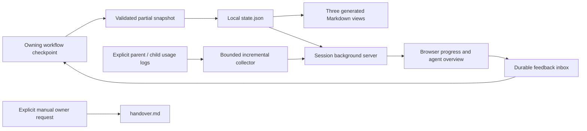

## Placement and data flow

`th-projects/subskills/progress-dashboard` owns all implementation. Fixed assets
and Python scripts serve any workflow. Beads integration carries only launch,
checkpoint and retirement instructions; it does not own UI or telemetry logic.

## Efficiency and observations

The server polls attached usage sources at most once per three-second tick and
reads at most 1MiB of new bytes per source. Counters/offsets persist across restarts;
unchanged polls do not rewrite the cache. The browser independently refreshes.
Neither path calls a model, queries Beads/GitHub, or creates an agent. Parent
checkpoints publish changed fields and return cursor-based feedback batches capped
at ten entries and 8KiB. Surfaced items remain pending until disposition; an
oversized item is visibly a preview and requires an exact full-item read before
interpretation. Native
delegation/report events supply child summaries; no transcript summarizer runs.

Conditional browser responses ignore collector heartbeat timestamps when all
meaningful content is unchanged. UI rows and disclosure controls retain identity
through unrelated polls, avoiding unnecessary payloads and lost keyboard focus.

Runtime-specific usage is an observation with source/freshness/coverage. Missing
or malformed counters stay unknown; partial reads do not contribute to measured
totals. Cached input is a subset of input, never another additive cost. Agent
status is separately reported by the parent and does not imply token freshness.
Optional telemetry errors remain visible without taking progress or feedback
offline. Partial coverage is identified alongside observed totals; a reachable
page does not attest that a stale parent or agent is executing.

## Persistence and recovery

Workspace identity pins actor and repository. Snapshot revision checks reject
stale writers. A lock serializes mutations; atomic replacements avoid torn files.
JSON commits the display snapshot; Markdown projections can be repaired on resume.
Feedback has a stable browser idempotency key, viewed revision, pending state and
explicit parent disposition. A lost HTTP acknowledgement does not duplicate it.
Pending feedback is never consumed just by reading. Manual handover is a separate
command and has no automatic caller, including stop or compaction.

## Trust and lifecycle

The server exposes fixed assets, the current projection, allowlisted artifacts
and one feedback POST. A capability URL, strict Host/Origin checks and CSP cover
the local browser transport. Default binding is loopback; an explicit Tailscale
IPv4 bind is available without modifying Tailscale configuration. There are no
commands, tracker writes, arbitrary file routes, or authority-granting APIs.
Transcript paths are explicit and private; only normalized counters reach the UI.
Repeated launch reuses the verified instance. Stop authenticates instance/PID and
preserves the workspace and waits for its listener to stop; stale metadata never
authorizes signalling another PID. Read-only commands do not create a workspace
for a mistyped slug, and input reads are bounded before parsing.

## Verification

Behavioral storage/HTTP/lifecycle tests and incremental adapter tests run in the
package validator and CI. A real Chromium journey covers feedback, lost-response
retry, drafts, hostile text, usage, responsive layout and offline behavior; lack
of a browser is an explicit skip. Independent review checks the standalone
surface before thin looper wiring is accepted.
